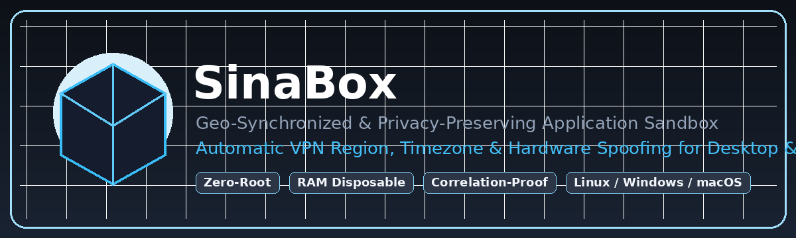

# 📦 SinaBox

<p align="center">
  
</p>

<p align="center">
  <strong>The First Privacy-First, Geo-Synchronized Application Sandbox & Identity Spoofer for Desktop & Terminal.</strong>
</p>

<p align="center">
  <a href="#-the-problem-why-sinabox"></a>
  <a href="#-features"></a>
  <a href="#-quick-start"></a>
  <a href="LICENSE"></a>
</p>

---

## 💡 The Problem: Why SinaBox?

Have you ever connected to a VPN in Germany, the US, or the UK, only to be **blocked, flagged, or shadowbanned** by modern applications and AI platforms like **Google Antigravity, Claude, ChatGPT, Stripe, Steam, Discord, or Banking portals**?

Here is the dirty secret of how applications detect you:
1. **The Timezone & Clock Trap**: Your VPN gives you a US or European IP, but your operating system (`/etc/localtime`, glibc `tzset()`, Windows Timezone) still broadcasts your local physical timezone (e.g. Tehran, UTC+3:30 or local time). Anti-fraud & telemetry algorithms spot this discrepancy immediately.
2. **GeoClue & Wi-Fi Triangulation**: Even with an active VPN tunnel, applications query system location daemons (D-Bus `GeoClue2`, CoreLocation, or Wi-Fi BSSID beacons) to determine your exact physical desk address.
3. **Hardware Fingerprint Continuity**: Proprietary clients read `/etc/machine-id`, DMI BIOS serials, and CPU models, permanently tracking your device across different accounts and IP addresses.
4. **Microphone & Camera Surveillance**: In traditional app runners, granting audio playback permission automatically hands the application unprompted background microphone recording access.

**Existing solutions don't solve this:**
- Firejail is notorious for SUID-root privilege escalation vulnerabilities.
- Anti-detect browsers (Camoufox, Multilogin) only run web pages and **cannot isolate desktop apps** (Telegram, Antigravity, Discord, Spotify, CLI binaries).
- Standard container tools (Docker, Podman) are clunky, require root or heavy daemon setups, and lack desktop context menu ergonomics.

---

## ⚡ What is SinaBox?

**SinaBox** is a zero-root, privacy-engineered sandbox framework that wraps any application on your machine. In milliseconds, it dynamically detects your active VPN/proxy's geographic exit node and binds the application to an isolated, spoofed reality:

```
[ Active VPN Exit: New York, US ]
               │
               ▼  (Auto-Synced by SinaBox)
┌────────────────────────────────────────────────────────┐
│                   SinaBox Sandbox                      │
│                                                        │
│  • Public IP      : 104.28.19.42 [US]                  │
│  • Timezone       : America/New_York (EST)             │
│  • /etc/localtime : Matched to NY zoneinfo             │
│  • Locale / Lang  : en_US.UTF-8                        │
│  • Machine ID     : Ephemeral / Randomized             │
│  • Hardware Model : ThinkPad X1 / Dell XPS (Spoofed)   │
│  • Location API   : Masked / Zero Leaks                │
│  • Microphone     : Virtual Silence Sink (--no-mic)    │
│  • Webcam         : Hidden Devices (--no-cam)          │
│  • Storage        : Persistent OR Disposable RAM       │
└────────────────────────────────────────────────────────┘
```

---

## ✨ Killer Features

### 🌍 1. Dynamic Geo-Synchronization (Zero Config)
SinaBox queries your active network interface and extracts your current public IP, country, city, and IANA timezone. It dynamically mounts `/usr/share/zoneinfo/<timezone>` over `/etc/localtime`, configures `TZ`, sets matching `LANG` and `LC_ALL`, and aligns the application with your VPN.

### 🛡️ 2. 100% Unprivileged (Zero-SUID Rootless)
Built strictly on unprivileged Linux User Namespaces and Bubblewrap (`bwrap`). SinaBox never runs with `sudo` and introduces zero attack surface for local privilege escalation.

### 💾 3. Persistent vs. Disposable RAM Modes
- **Persistent Mode (Default)**: Keeps your logins, chats, and cache safe inside an isolated box directory (`~/.local/share/sinabox/boxes/<app>/home`). Turn off or reboot your PC—your session stays intact!
- **Disposable RAM Mode (`--disposable`)**: Runs 100% in volatile memory (`tmpfs`). The moment you close the application, **100% of all files, cookies, and history vanish permanently from RAM**, leaving zero forensic traces on your SSD.

### 🎙️ 4. Granular Permission Killswitches
Take complete control over your hardware sensors:
- `--no-mic`: Blocks audio input / feeds a virtual silence sink so you can listen to music or voice chats without fear of background eavesdropping.
- `--no-cam`: Hides all `/dev/video*` capture devices.
- `--no-gpu`: Disables hardware acceleration ioctls and forces Mesa software rasterization (neutralizes GPU fingerprinting).
- `--no-net`: Completely severs network access (offline air-gap for inspecting suspicious files).
- `--no-loc`: Masks system location daemons (GeoClue).
- `--no-storage`: Denies access to your personal `$HOME`.

### 💻 5. Hardware Identity & Machine-ID Spoofing
Avoid cross-account correlation:
- Generates randomized or preset DMI identities (Lenovo ThinkPad, Dell XPS, Apple MacBook, ASUS ROG).
- Synthesizes `/etc/machine-id` and `/var/lib/dbus/machine-id` on-the-fly.
- Instant commands: `sinabox hardware reset` and `sinabox hardware show`.

### ⚙️ 6. Custom Reusable Profiles
Create your own custom security recipes:
```bash
# Save a paranoid profile
sinabox profile create custom01 --no-mic --no-cam --no-gpu --disposable

# Launch anytime
telegram-desktop --sinabox --custom01
# Or
sinabox run --profile custom01 telegram-desktop
```

### 🖱️ 7. Full Desktop & Context Menu Integration
SinaBox doesn't just live in the terminal. It automatically patches all system applications (`.desktop` entries) and file manager scripts:
- **Taskbar / Dock / App Menu**: Right-click any app icon -> **Open with SinaBox** or **Open with Custom SinaBoxes...**
- **File Manager**: Right-click any AppImage, script, or binary -> **Open with SinaBox**.

---

## 🚀 Installation & Quick Start

### Linux Installation
```bash
git clone https://github.com/programmer-1998/SinaBox.git
cd SinaBox
python3 install_desktop.py
python3 desktop_patcher.py
```

*Prerequisite: `bubblewrap` (installed by default on Fedora/Arch; run `sudo apt install bubblewrap` on Ubuntu/Debian/Zorin).*

### CLI Usage & Examples

```bash
# 1. Run any application in SinaBox
sinabox telegram-desktop

# 2. Run Chrome 100% in RAM with zero disk footprints
sinabox run --disposable google-chrome-stable

# 3. Mute microphone and hide camera in Discord
sinabox run --no-mic --no-cam discord

# 4. Air-gapped offline analysis
sinabox run --no-net ./suspicious_tool

# 5. Reset hardware fingerprint
sinabox hardware reset

# 6. Check active VPN Geo sync status
sinabox sync-vpn

# 7. Use the convenient flag wrapper
telegram-desktop --sinabox --custom01
```

---

## 🖥️ Cross-Platform Support

| Platform | Sandboxing Core | Context Menu | Privilege Level | Status |
| :--- | :--- | :--- | :--- | :--- |
| **Linux** | Bubblewrap (`bwrap`) + User Namespaces | Nautilus / Dolphin / Taskbar Actions | 100% Rootless | **Production Ready** |
| **Windows** | AppContainer + Process Token Isolation | HKCU Shell Verbs (`.reg`) | Zero Admin | **Supported (`windows/`)** |
| **macOS** | Apple Seatbelt (`sandbox-exec`) | Finder Quick Actions | User-Level | **Supported (`macos/`)** |

---

## 📜 License
Distributed under the **MIT License**. Created with ❤️ by **Sina Khanzadeh**.
